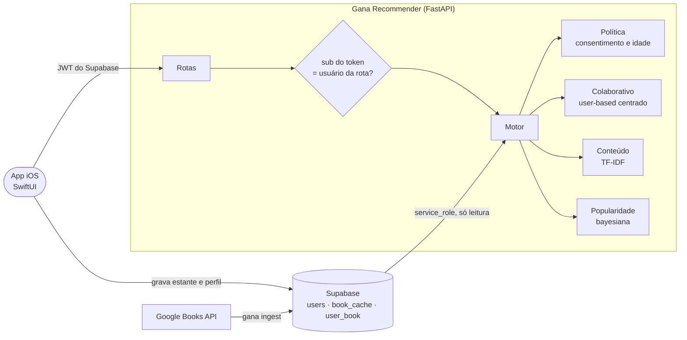

<div align="center">

# Gana Recommender

**Motor de recomendação híbrido do Gana, uma rede social de livros para iOS.**
Python · FastAPI · Supabase · Google Books API · cold start · LGPD · classificação etária

[](https://github.com/ceciliatv/gana-recommender/actions/workflows/ci.yml)


[](LICENSE)

[English version](README.en.md)

</div>

---

O **Gana** é um app iOS (SwiftUI) em que as pessoas montam estantes ("Quero ler", "Lendo", "Lido", "Abandonado"), escrevem reviews e seguem outros leitores. Foi desenvolvido em equipe na Apple Developer Academy | UNICAMP. Este repositório é o **serviço de recomendação** que o app consome: o que aparece em "Sugestões para você", "Em alta" e "Quem leu este também leu".

Ele começou como uma POC (o [primeiro commit](https://github.com/ceciliatv/gana-recommender/commit/f8436b5) deste repositório guarda o código original) e evoluiu por **spec-driven development** até:

- um **híbrido ponderado** (filtragem colaborativa + conteúdo + popularidade) em que o peso de cada componente se adapta ao histórico de cada pessoa, fundamentado em *Recommender Systems: The Textbook* (Charu Aggarwal);
- **cold start** em camadas para quem acabou de chegar e para livros que ninguém leu ainda;
- integração com a **Google Books API** para popular o catálogo;
- **LGPD e classificação etária**: consentimento, minimização, direitos do titular, autenticação por JWT e filtro de conteúdo adulto para menores;
- **avaliação offline reproduzível** num dataset público com o mesmo formato do app, com números honestos (inclusive onde o motor perde).

```text
GET /recommend/u9-novo?n=2          # pessoa que acabou de chegar e escolheu Fantasy e Science Fiction no onboarding
{
  "user_id": "u9-novo",
  "strategy": "cold_start_genres",
  "recommendations": [
    {"title": "O Nome do Vento",     "score": 0.9559, "reasons": ["do gênero que você escolheu: Fantasy"], ...},
    {"title": "A Guerra dos Tronos", "score": 0.8676, "reasons": ["do gênero que você escolheu: Fantasy"], ...}
  ]
}
```

<sub>Resposta real da API rodando com os dados sintéticos do repositório.</sub>

## Sumário

- [Arquitetura](#arquitetura)
- [O motor](#o-motor)
- [Cold start](#cold-start)
- [LGPD e classificação etária](#lgpd-e-classificação-etária)
- [Google Books API](#google-books-api)
- [Avaliação](#avaliação)
- [API](#api)
- [Rodando localmente](#rodando-localmente)
- [Da POC ao serviço](#da-poc-ao-serviço)
- [Estrutura](#estrutura)

## Arquitetura



O app grava as estantes no Supabase; o serviço lê com a `service_role` (só no servidor), monta o estado em memória e responde. `POST /refresh` recarrega depois de uma gravação.

## O motor

Para cada pessoa, o score de um livro é:

```
score = a · colaborativo + (1 − a − g) · conteúdo + g · popularidade

a = 0,3 · n / (n + 5)        peso do colaborativo: cresce com o histórico, com teto
g = 0,5 · 5 / (n + 5)        prior de popularidade: some conforme a pessoa lê
```

`n` é o número de livros na estante da pessoa, e os três componentes viram percentis antes de somar.

| Componente | Como funciona |
|---|---|
| **Colaborativo** | user-based (Aggarwal, cap. 2). Os julgamentos ("Lido", "Abandonado", reviews) são **centrados na média da pessoa**, então abandonar um livro vira sinal **negativo** (na POC, abandonar valia 1,0 e ainda contava como gosto). "Lendo" e "Quero ler" entram com peso positivo fixo. Similaridade de cosseno sobre os vetores centrados; predição pelos 20 vizinhos mais próximos. |
| **Conteúdo** | TF-IDF sobre categoria principal (peso 2), categorias e autores. O perfil é a soma dos livros ponderada pelo sinal de preferência, então um abandono afasta o perfil daquele tipo de livro. |
| **Popularidade bayesiana** | `log(1 + v) · (v·R + m·C) / (v + m)`: volume de leitores vezes a nota média puxada para a média global quando há pouca evidência. |

Cada recomendação traz **motivos** e a resposta diz a **estratégia** usada:

```json
{"title": "O Morro dos Ventos Uivantes",
 "reasons": ["2 leitores com gosto parecido com o seu gostaram",
             "mesma categoria de Orgulho e Preconceito (Romance)"]}
```

## Cold start

| Situação | Estratégia |
|---|---|
| Sem consentimento (ou criança sem consentimento dos responsáveis) | `non_personalized`: popularidade, filtrada por idade |
| 0 leituras, sem gêneros | `popularity` |
| 0 leituras, com gêneros do onboarding | `cold_start_genres`: metade conteúdo dos gêneros, metade popularidade |
| 1 a 4 leituras | `hybrid`: o conteúdo usa a estante **e** os gêneros do onboarding; a popularidade ainda pesa bastante |
| 5 ou mais | `hybrid`, com o colaborativo ganhando espaço |

**Livro novo**, sem nenhuma leitura, entra pelo conteúdo: quem lê ficção científica recebe *Projeto Hail Mary* mesmo sem ninguém ter lido (testado em `tests/test_cold_start.py`).

## LGPD e classificação etária

Resumo do que está implementado (detalhes, bases legais e limitações em [`docs/LGPD.md`](docs/LGPD.md); não é parecer jurídico):

| Princípio | No código |
|---|---|
| Minimização | o serviço lê só `id`, `birth_date`, consentimentos e `favorite_genres`; o `GET /users` da POC, que expunha nome e username de todos, foi removido |
| Consentimento | sem `personalization_consent`, a pessoa recebe recomendações genéricas **e as leituras dela não treinam o modelo de ninguém** (teste compara as recomendações dos outros com e sem essas leituras) |
| Crianças | menores de 12 anos só são personalizados com `parental_consent` |
| Classificação etária | menores de 18 **e idade desconhecida** nunca recebem livros `MATURE` (campo `maturityRating` do Google Books) nem categorias sensíveis, em nenhuma rota |
| Acesso, portabilidade e eliminação | `GET` e `DELETE /users/{id}/data` |
| Segurança | com `SUPABASE_JWT_SECRET`, as rotas por usuário exigem o JWT do Supabase e o `sub` precisa ser o próprio usuário (401/403 testados) |
| Logs | id pseudonimizado (`sha256` com sal), nunca o UUID |

Os campos novos estão em [`supabase/migrations/`](supabase/migrations/).

## Google Books API

[`google_books.py`](src/gana/google_books.py) busca e normaliza livros para o formato do `book_cache`: ISBN-13 (ou 10), autores, ano, editora, capa em `https`, `main_category` a partir da hierarquia ("Fiction / Fantasy" → "Fiction"), categorias achatadas e `maturity_rating`. Tem cache com TTL, chave opcional e retentativa com espera exponencial para 429 e 5xx.

```bash
gana ingest "torto arado" --lang pt --dry-run   # imprime
gana ingest "torto arado" --lang pt             # grava no book_cache
```

A cota anônima da API é compartilhada e acaba rápido (durante o desenvolvimento ela respondeu 429), por isso a chave `GOOGLE_BOOKS_API_KEY` é recomendada e os testes usam fixtures no formato da API, sem rede.

## Avaliação

O banco do app tem poucos dados e são dados pessoais. Para um repositório público, a avaliação usa o **Goodbooks-10k** (CC BY-SA 4.0) convertido para o esquema do Gana: nota 1 vira "Abandonado"; notas de 2 a 5 viram "Lido" com review; tags do Goodreads viram categorias. Amostra de teste: 3.000 usuários (semente 42), 10.000 livros, 337 mil interações. Ranking completo, sem amostrar negativos. Os pesos do motor foram escolhidos numa **amostra de validação separada** (semente 7), não na de teste. Relatório completo em [`reports/offline.md`](reports/offline.md).

**Leave-one-out** (um livro bem avaliado de cada pessoa escondido; 2.999 usuários):

| Estratégia | HR@10 | NDCG@10 |
|---|---:|---:|
| Popularidade (contagem) | 0,0634 | 0,0358 |
| Colaborativo | 0,0714 | 0,0457 |
| Conteúdo | 0,0847 | 0,0527 |
| Híbrido, peso fixo α = 0,5 (como a POC) | 0,0937 | 0,0576 |
| **Híbrido adaptativo (Gana)** | **0,0927** | **0,0592** |

O híbrido adaptativo tem o melhor NDCG@10: **+65% sobre a popularidade** e acima de qualquer peso fixo testado.

**Cold start** (500 pessoas de teste com só `k` livros visíveis e três gêneros de onboarding), Recall@20:

| Estratégia | k = 0 | k = 1 | k = 3 |
|---|---:|---:|---:|
| Popularidade (contagem) | **0,2454** | **0,2437** | 0,2403 |
| Colaborativo | — | 0,2238 | 0,2401 |
| Conteúdo só da estante | 0,2418 | 0,1579 | 0,2114 |
| **Em camadas (Gana)** | 0,2331 | 0,2264 | **0,2485** |

Leitura honesta: com 3 livros a estratégia em camadas já é a melhor, mas **com 0 ou 1 livro a popularidade pura ainda ganha** (por 5% a 7%). No Goodbooks poucos livros dominam todas as estantes, e os "gêneros de onboarding" simulados são categorias amplas (Young Adult, Classics). Os gêneros ficaram no motor porque a primeira tela precisa refletir o que a pessoa disse que gosta; o custo medido dessa escolha está na tabela. A primeira versão do motor perdia bem mais (0,213 com k = 0) e foi corrigida com o prior de popularidade; o caminho está no [registro da spec 003](docs/specs/003-cold-start/spec.md#registro-de-implementação).

## API

Os caminhos e campos que o app iOS já consumia continuam iguais; `strategy`, `alpha` e `reasons` são campos novos, que o `Decodable` do Swift ignora se não conhecer.

| Método | Rota | Descrição | Auth |
|---|---|---|---|
| `GET` | `/recommend/{user_id}?algorithm=&n=&alpha=&genres=` | recomendações (hybrid, collaborative ou content) | usuário |
| `GET` | `/similar/{google_books_id}?n=&user_id=` | quem leu este também leu, com conteúdo como complemento | opcional |
| `GET` | `/trending?n=&user_id=` | em alta (popularidade bayesiana) | opcional |
| `GET` | `/books` | catálogo | não |
| `POST` | `/interactions` | atualiza a estante em memória | usuário |
| `POST` | `/refresh` | recarrega do Supabase | token válido |
| `GET` | `/users/{id}/data` | dados da pessoa (LGPD) | usuário |
| `DELETE` | `/users/{id}/data` | eliminação (LGPD) | usuário |
| `GET` | `/health` | status | não |

Sem `user_id`, `/similar` e `/trending` aplicam o filtro de conteúdo mais protetivo (o de menor de idade).

## Rodando localmente

```bash
git clone https://github.com/ceciliatv/gana-recommender.git && cd gana-recommender
python -m venv .venv && source .venv/bin/activate
pip install -e ".[dev,supabase]"

gana serve                      # http://127.0.0.1:8000/docs, com dados sintéticos
gana serve --host 0.0.0.0       # para o app no iPhone, na mesma rede
gana evaluate                   # baixa o Goodbooks-10k e gera reports/offline.md (alguns minutos)
pytest                          # 58 testes, sem rede
```

Para usar o banco real, copie `.env.example` para `.env` e preencha `SUPABASE_URL`, `SUPABASE_SERVICE_KEY` e, para ligar a autenticação, `SUPABASE_JWT_SECRET`. Aplique as migrações de [`supabase/migrations/`](supabase/migrations/).

## Da POC ao serviço

O primeiro commit é a POC como ela era. Cada mudança depois disso começou como uma spec em [`docs/specs/`](docs/specs/), apontando o problema no código da POC:

| Spec | Problema na POC | O que mudou |
|---|---|---|
| [001](docs/specs/001-reestruturacao/spec.md) | módulos soltos, rating implícito duplicado, nenhum teste, `GET /users` expondo dados | pacote `gana`, tipos, regra única, testes de contrato com o app |
| [002](docs/specs/002-hibrido-ponderado/spec.md) | abandonar contava como gosto; peso fixo para todos; normalização só no top-3n | centragem, vizinhança, peso adaptativo, motivos |
| [003](docs/specs/003-cold-start/spec.md) | usuário novo recebia lista vazia; "em alta" só contava interações | estratégia em camadas, popularidade bayesiana, gêneros do onboarding |
| [004](docs/specs/004-google-books/spec.md) | catálogo só pelo app, sem classificação etária | cliente com retentativa, cache e `maturity_rating` |
| [005](docs/specs/005-lgpd-e-classificacao-etaria/spec.md) | qualquer um via a recomendação de qualquer um | consentimento, idade, JWT, rotas do titular |
| [006](docs/specs/006-avaliacao-e-ci/spec.md) | avaliação com 8 usuários sintéticos | Goodbooks-10k, dois protocolos, CI |

As specs também registram o que deu errado no caminho e como foi corrigido: a centragem que transformava "Lendo" em rejeição, a média bayesiana pura que ficou perto de zero na avaliação, e o peso adaptativo original que perdeu para o peso fixo.

## Estrutura

```
src/gana/
├── domain.py              # User, Book, Interaction, STATUS_RATING
├── privacy.py             # idade, consentimento, conteúdo sensível, pseudonimização
├── google_books.py        # cliente e normalização
├── data/                  # fonte Supabase, dados sintéticos, estado em memória
├── recommender/           # colaborativo, conteúdo, popularidade, motor
├── api/                   # FastAPI: rotas, esquemas, autenticação
├── evaluation/            # Goodbooks-10k adaptado e protocolos offline
└── cli.py                 # gana serve | evaluate | ingest
supabase/migrations/       # esquema lido pelo serviço e campos das specs 003 e 005
docs/specs/                # specs 001–006
docs/LGPD.md
tests/                     # 58 testes
```

## Créditos

O app iOS do Gana foi desenvolvido em equipe na Apple Developer Academy | UNICAMP (o repositório do app é privado). O motor de recomendação, a API e este repositório são de **Maria Cecília Torres Vianna** · [LinkedIn](https://linkedin.com/in/cecília-vianna-708a67285).

Dados de avaliação: [Goodbooks-10k](https://github.com/zygmuntz/goodbooks-10k), de Zygmunt Zając, CC BY-SA 4.0 (baixados na hora, não versionados).
